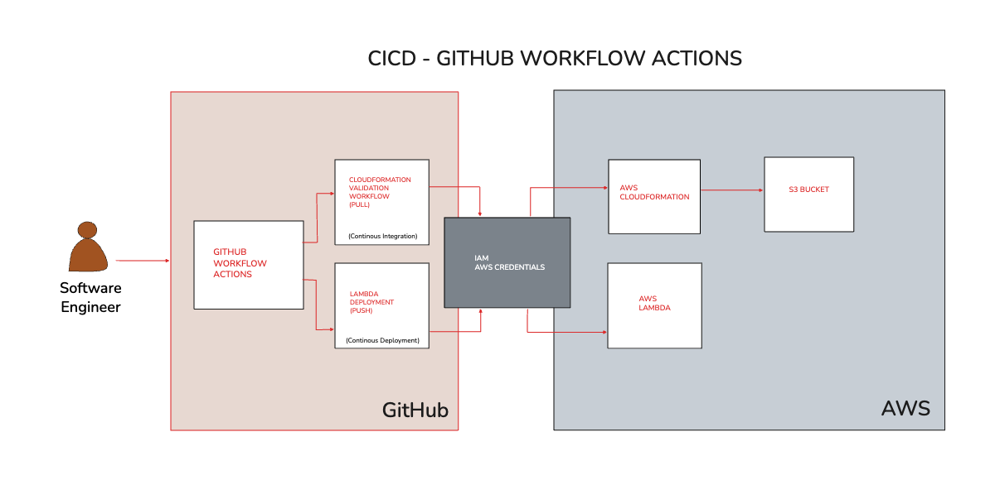

# Project name: lambda-cicd

## The problem
All enterprises have a common challenge; code bugs can quickly disable or break a business site. More specifically, it's software engineers that need to deal with these software bugs that can create havoc in day to day business operations. Instead of deploying new code manually, where a simple typo or nesting issue creates a new bug, a GitHub Actions workflow automates the Continuous Integration and Continuous Deployment (CICD) process and verifies code at a GitHub pull request. This automation alerts software engineers to correct bugs before deployment can happen.

## What I built
I built two GitHub workflows. The first validates an AWS CloudFormation template, builds a temporary stack with an S3 bucket on a pull request and then the push workflow updates the Lambda function code on push. The continuous integration, during a pull request, and continuous deployment, during a push, provides an efficient CICD process. Finally, the S3 bucket that was created for this test environment is deleted on merge.

## Decisions I made
I chose to name each test stack with the pull request number instead of a fixed name, because two open pull requests never share the same name and the workflow knows which stack to delete as the name includes the pull request number. I chose to validate the template before creating the stack, instead of deploying first, because CloudFormation would create a failed or half-built stack that someone has to find and delete.

## What broke and how I fixed it
The Lambda deploy workflow failed at the Deploy Lambda Function step with a ResourceNotFoundException error. The problem was that the function name in the workflow, my-test-CICD-Lambda, didn’t match the function name in AWS, my-test-cicd-lambda, because AWS names are case sensitive. I found it by reading the error in the Actions log and comparing it to lambda-deploy.yaml code, and I fixed it by removing the capitalization.

## Result
Now, when a developer opens a pull request, the template is validated and tested in about 16 seconds, with no manual steps. When code is pushed to main, the Lambda function updates in about 12 seconds. Before this, a developer would have had to validate by hand, which takes ~1 hour and risks adding bugs.

## How to run it
1. In GitHub, go to Repo → Settings → Secrets and variables → Actions → New repository secret. Create two secrets named exactly AWS_ACCESS_KEY_ID and AWS_SECRET_ACCESS_KEY, matching what the workflows read.
2. Before the deploy workflow can work, a Lambda function named my-test-cicd-lambda must already exist in the us-west-1 region.
3. To see the validation workflow run, open a pull request that changes a file in the cloudformation folder.

## Links
- [Medium write-up](https://medium.com/@gustavo.lugo2025/test-the-recipe-before-you-serve-it-1b7a71404e80)
- [Youtube Video]
